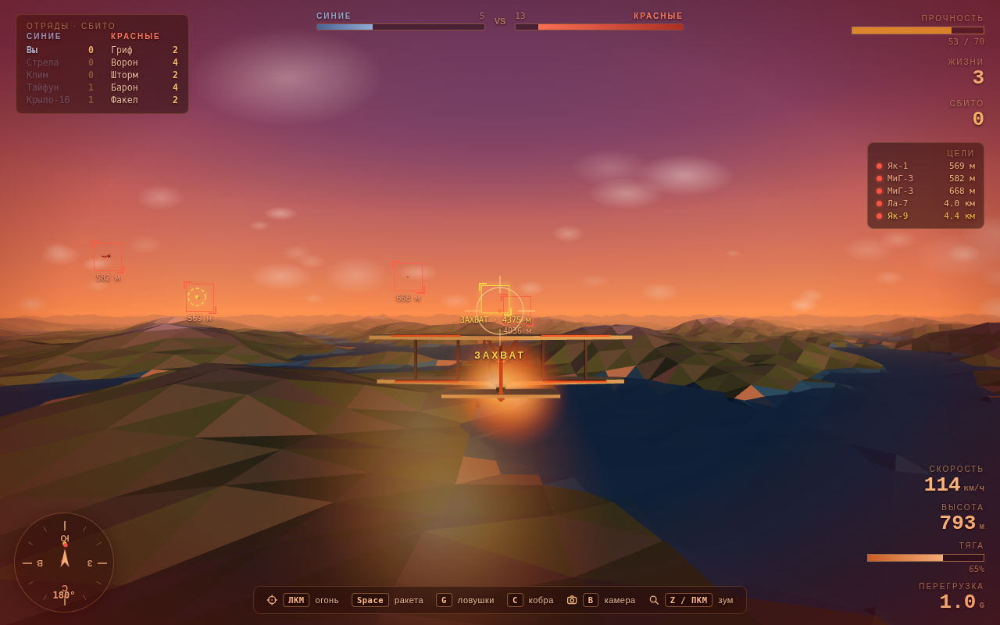
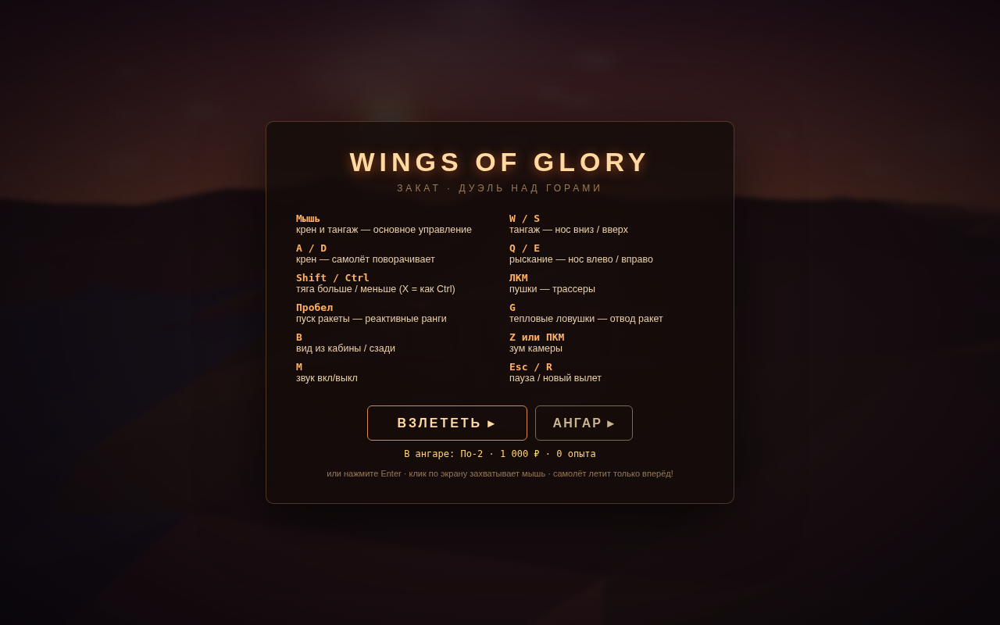
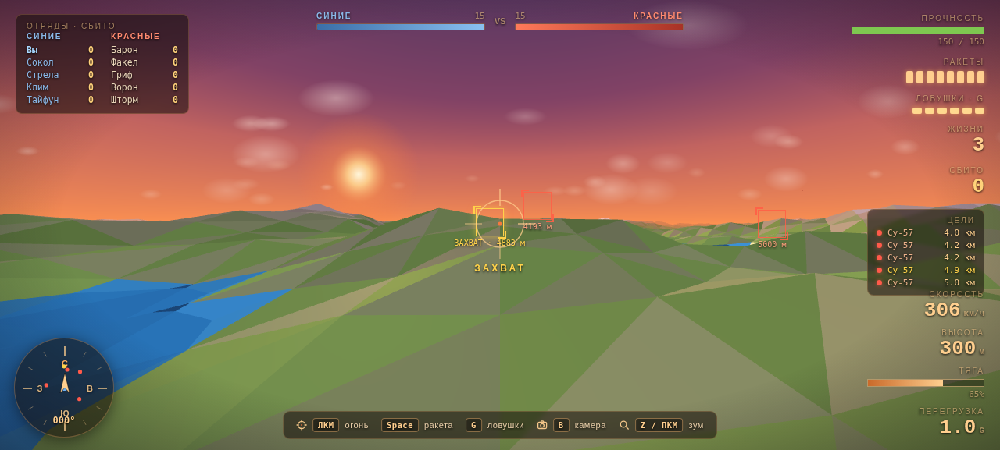

# Wings of Glory

Аркадный сетевой воздушный бой на Three.js: советские самолёты от По-2 до Су-57, ракеты, тепловые ловушки и онлайн-режим 5 на 5 — до 10 реальных игроков в одном небе.



## Возможности

- **10 самолётов I–X ранга** — поршневая классика и современные реактивные (Су-35, Су-57 с подвижным вектором тяги)
- **Сетевой режим 5×5** — красные против синих, до 10 игроков; пустые слоты занимают боты
- **Профили и аккаунты** — уникальные никнеймы (дубликаты отклоняет сервер), регистрация и вход, прогресс и ангар хранятся на сервере и доступны с любого устройства
- **Вооружение и выживание** — пушки, самонаводящиеся ракеты, тепловые ловушки (уводят ракеты на дистанции больше 120 м), трёхступенчатое предупреждение о пуске (600 / 350 / 150 м)
- **Высший пилотаж** — манёвр «Кобра» (клавиша C), экономика, покупка и прокачка самолётов в ангаре



## Структура проекта

| Путь | Что это |
|------|---------|
| `download/wings_of_glory.html` | Игра — один самодостаточный HTML-файл (Three.js r128 с CDN) |
| `public/game.html` | Копия игры, которую раздаёт Next.js по `/` |
| `mini-services/wog-server/` | Мультиплеер-сервер: socket.io на :3030, аккаунты, профили, SQLite (`data/wog.db`) |
| `src/` | Next.js-хост: раздаёт игру как главную страницу, fallback-iframe |
| `worklog.md` | Журнал разработки: все задачи и изменения |

## Запуск локально

Нужен [Bun](https://bun.sh) (или Node.js 20+ для хоста).

```bash
# 1. Хост — Next.js, порт 3000
bun install
bun run dev

# 2. Мультиплеер-сервер — socket.io, порт 3030
cd mini-services/wog-server
bun install
bun run dev
```

Открыть `http://localhost:3000`. Игра без запущенного сервера доступна в одиночном режиме с ботами.

## Как устроена сетевая игра

Клиент подключается к серверу по WebSocket (`socket.io`, путь `/?XTransformPort=3030`). Сервер ведёт комнаты формата 5×5: распределяет игроков по командам, заполняет недостающие слоты ботами, синхронизирует позиции, стрельбу, ракеты и ловушки, начисляет награды и пишет прогресс в SQLite. Пароль и токен сессии хранятся только на сервере — поэтому один профиль можно открыть с любого устройства.

## Деплой

Хост (Next.js) публикуется на любой Node-платформе; сервер мультиплеера — отдельный процесс (`mini-services/wog-server`), которому нужен постоянный порт (Render / Railway / Fly.io / VPS). Для чисто статической публикации (например, GitHub Pages) достаточно файла `wings_of_glory.html` — одиночный режим с ботами работает без сервера.


